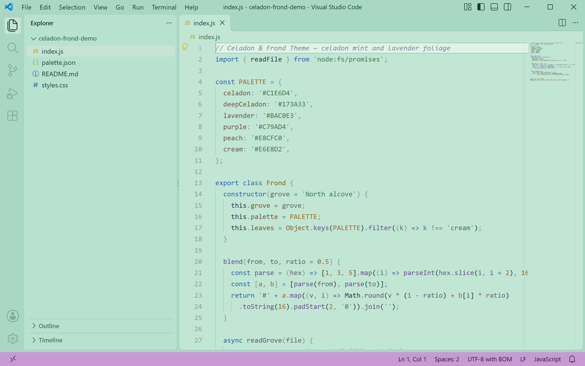
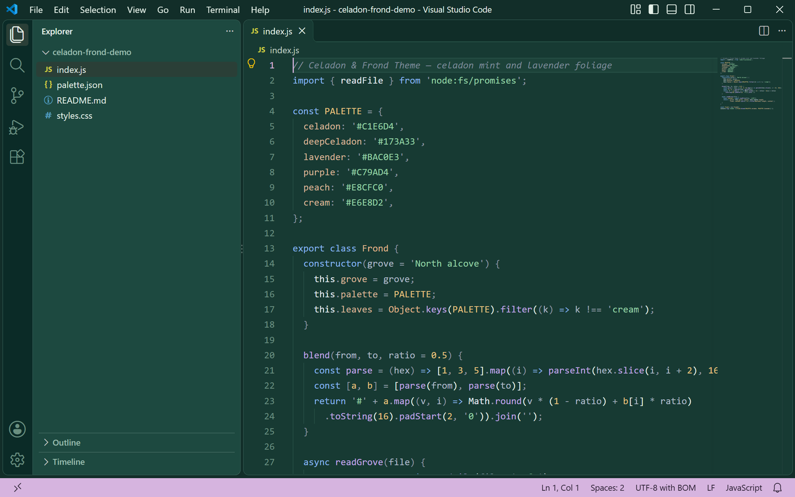

<div align="center">


# Celadon & Frond Theme

**Celadon mint and lavender foliage - one quiet garden in a light and a dark cut.**

[](https://github.com/vaxicy/celadon-frond-theme)
[](https://code.visualstudio.com/)
[](#two-cuts)
[](LICENSE)
[](https://github.com/vaxicy/celadon-frond-theme)

[English](#-english) - [简体中文](#-简体中文)

</div>

---

## English

**Celadon & Frond Theme** takes the celadon green of glazed ceramic and the dusty lavender
of dried fronds, then gives them a daylight and a night cut. Mint stays the surface; the
lavender-purple lives in the status bar, the active tab and the focus ring.

<a id="two-cuts"></a>

### Two cuts

| Cut | Editor | Chrome | Accent |
|---|---|---|---|
| **Light** | celadon `#C1E6D4` | pale mint `#A8D8C4` | lavender-purple `#C79AD4` |
| **Dark** | deep celadon `#173A33` | midnight mint `#0B2B27` | dusty lavender `#D6B4DF` |

### Screenshots

#### Light


#### Dark


### Install

1. Open **Extensions** (`Ctrl+Shift+X`), search **Celadon & Frond Theme**, click **Install**.
2. `Ctrl+K Ctrl+T` -> pick **Celadon & Frond Light** or **Celadon & Frond Dark**.

```bash
code --install-extension celadon-frond-theme-1.0.0.vsix
```

### What's tuned

- **144 hand-placed UI colours** per cut, with matching syntax and semantic tokens.
- **De-collided bases.** The source card's cream `#F5F2E0` was 0.009 from `olive-dream`'s
  editor; instead the celadon mint `#C1E6D4` became the light editor (0.086 from any other
  theme). The purple, peach and lavender were each re-tuned until their nearest neighbour
  was at least 0.04 away.
- Mint surfaces, lavender accents: a quiet palette that stays readable all day.

The full colour table lives in [`COLOR-SPEC.md`](COLOR-SPEC.md).

---

## 简体中文

**Celadon & Frond Theme** 取青瓷釉的薄荷绿与干蕨叶的灰紫，给出白昼与夜晚两个切面。
薄荷做表面，淡紫负责状态栏、活动标签与焦点框。

### 两个切面

| 切面 | 编辑区 | 工具栏 | 强调色 |
|---|---|---|---|
| **Light** | 青瓷 `#C1E6D4` | 淡薄荷 `#A8D8C4` | 灰紫 `#C79AD4` |
| **Dark** | 深青瓷 `#173A33` | 深夜薄荷 `#0B2B27` | 灰淡紫 `#D6B4DF` |

### 截图

#### Light


#### Dark


### 安装

1. 在 VS Code 中打开 **扩展**（`Ctrl+Shift+X`），搜索 **Celadon & Frond Theme** 并点击 **安装**。
2. `Ctrl+K Ctrl+T` -> 选择 **Celadon & Frond Light** 或 **Celadon & Frond Dark**。

```bash
code --install-extension celadon-frond-theme-1.0.0.vsix
```

### 调校细节

- 每个切面 **144 个手工设定的 UI 颜色**，配成套的语法与语义 token。
- **底色避撞**：原卡的奶油色 `#F5F2E0` 与 `olive-dream` 编辑区只差 0.009；改用青瓷薄荷
  `#C1E6D4` 做浅色底（与最近邻差 0.086）；紫、桃、薰衣草都逐色压到最近邻 ≥ 0.04。
- 薄荷表面 + 灰紫强调，是一套安静、适合长时间阅读的配色。

完整配色表见 [`COLOR-SPEC.md`](COLOR-SPEC.md)。

---

## License

Non-Commercial License - see [LICENSE](LICENSE).
